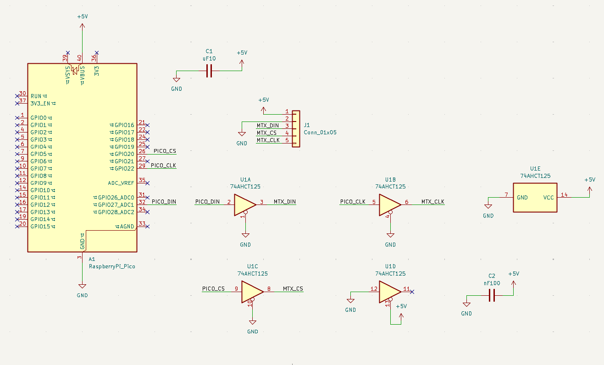
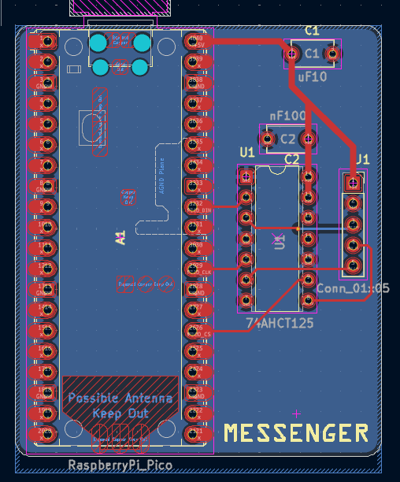
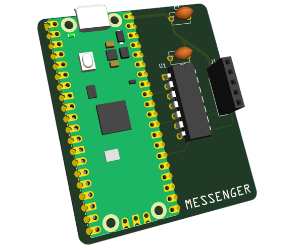

# Messenger
The messenger is a display that shows daily quotes or phrases.
 
[Image coming soon...]

It works by using LED matrices, which allows to use tons of LED while using less pins. 

## About the Project

The messenger is going to be a multitasker!

I want it display daily encouraging motivating quotes or phrases to inspire in the morning. During the day
It the messenger is going to be displayed. It will have different states based on the weather. 

## The schematic

## The PCB

## 3D

### Difficulties

In the beginning I had A LOT of troubleshooting. 
I was very overwhelmed because I didn't quite understand the guide I was using.

- Firstly I didn't know which MCU I should chose, which made me change my schematic a couple of times
- Secondly and probably what consumed the most time and patience were the pins connections.
  I wasn't familiar with this so I had to research a lot.
- And lastly was the placement and the routing of the components. 

Thankfully I got help from very kind people and was able to complete this project. 

### Currently working on ...

- the Firmware
  
### Next steps ...

- finish code
- assemble

## BOM 

